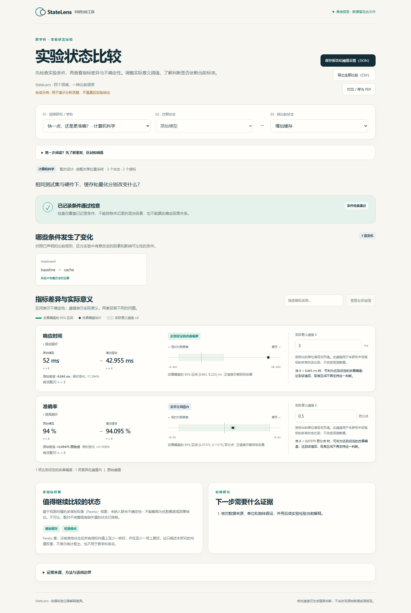

# StateLens · Experimental state comparison

The second generation of FrostLens: a portable **Codex / Claude Code skill** for comparing experimental states across disciplines.

Give the assistant a folder of experiment files. It inventories inputs, extracts available evidence, normalizes a comparison contract, checks declared controls and units, and produces a traceable interactive report. Suitable for controls/treatments, materials, operating states, ablations and paired before/after studies.

[中文](README.md) · [Download skill ZIP](https://github.com/feifeing/FrostLens/raw/refs/heads/main/downloads/compare-experiments-v0.2.0.zip) · [Installation](docs/INSTALL.md) · [First-generation refrigeration workbench](FROSTLENS.en.md)



## Install and try

Extract the skill ZIP and open a terminal in `compare-experiments`. Python 3.11+ is required; the skill has no third-party Python dependencies.

```bash
python scripts/install.py --target codex
# Alternatively:
python scripts/install.py --target claude
# A standalone synthetic demonstration:
python scripts/statelens.py demo --out demo-report --open
```

Use `$compare-experiments` in Codex CLI or `/compare-experiments` in Claude Code. Ask it to compare a folder, identify uncontrolled differences and retain provenance. Restart the host session if discovery has not refreshed. Host documentation links and installation scopes are in [INSTALL.md](docs/INSTALL.md).

## What is implemented

- Local extraction of CSV, TSV, XLSX cached values, JSON, JSONL and text/logs. Other formats become explicit host extraction tasks, never fabricated values.
- Comparison contracts defining the baseline, sampling unit, design, controls, metrics, units and practical margins.
- Unit conversion, missing-data diagnostics, strict paired alignment, deterministic paired/independent percentile bootstrap intervals, and descriptive mode when inference is unsupported.
- An offline HTML report with study/state selection, condition differences, metric intervals, practical-margin sensitivity, within-study Pareto tradeoffs, JSON and CSV export.
- Raw-file and normalized-data fingerprints, source records, reproducible settings, a portable installer and a standalone ZIP.

The demonstration contains fictional computing, materials, chemistry-control and thermal-engineering data. It is not validation on real experimental systems.

## Scope and limits

“Automatic” means format detection, routing and assistant-assisted interpretation. The Python extractor alone does not understand every instrument format or research design. Images, PDFs, audio/video and proprietary files require suitable host tools or a supported export. Graph digitization and derived features must preserve source locations and extraction uncertainty.

Studies share a workflow, not a universal score. Time samples, pixels and technical replicates are not automatically independent experimental units. Comparability checks cover declared controls only. Bootstrap labels are exploratory, unadjusted for multiple comparisons, and not causal or confirmatory significance claims. Practical margins are user choices, not estimated measurement error.

Bundled scripts make no network calls. Model-assisted extraction follows the host's own data policies. Generated reports embed supplied experimental evidence; review before sharing.

## Development

```bash
python -m unittest discover -s tests -p "test_statelens_*.py" -v
python tools/rebuild_statelens_demo.py
python tools/package_statelens.py
```

The original CoolProp refrigeration workbench remains independent at version 0.1; its instructions are in [FROSTLENS.en.md](FROSTLENS.en.md). StateLens skill version is 0.2.0. MIT license. The implementation is original to this project; bootstrap resampling and Pareto dominance are established methods.
