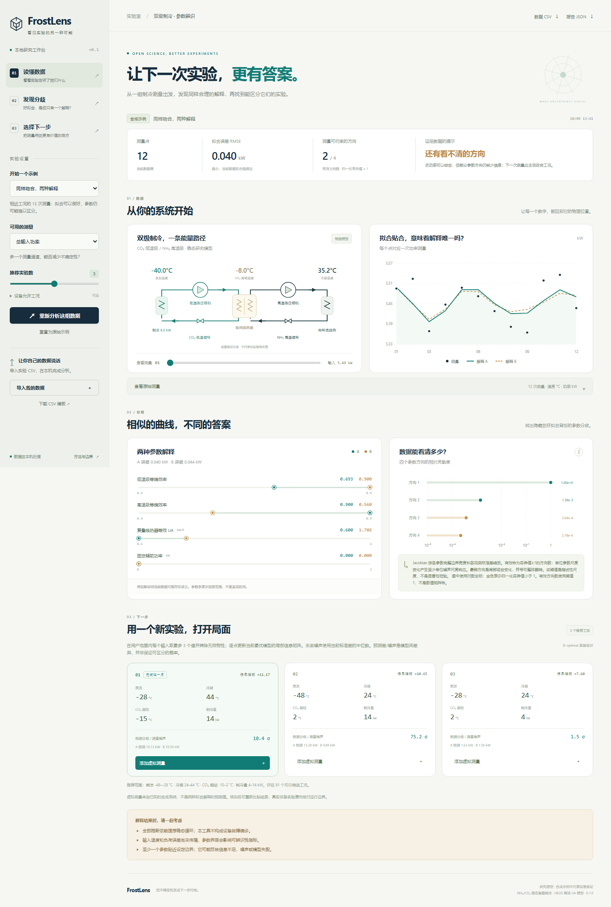

<div align="center">

# FrostLens · 霜镜

**两个解释，都拟合得很好。下一次实验，该怎么做？**

面向 NH₃/CO₂ 复叠制冷的开源实验侦探工作台。

[English](README.en.md) · [研究定位与原创边界](docs/RESEARCH.md) · [计算方法](docs/METHODS.md) · [验证记录](docs/VALIDATION.md) · [参与贡献](CONTRIBUTING.md)

</div>

FrostLens 把“拟合一条漂亮曲线”往前推进一步：寻找同样能解释数据、参数却不同的替代解释，显示当前数据看不清的方向，再推荐一批更有信息量的实验。



它连接**灰箱建模、参数可辨识性和实验方案设计**。制冷研究者可以导入工况 CSV；第一次接触这些概念的人，可以直接在虚拟实验室里看见证据如何改变判断。

## 三步开始

1. **载入数据**：选择内置案例，或导入自己的 CSV。
2. **看清分歧**：对比拟合、参数和弱辨识方向，而不只看拟合误差。
3. **选择下一次测量**：限定设备允许的工况，获得推荐；在内置案例里可追加虚拟测量并重新分析。

## 安装与运行

需要 Python 3.11 或更新版本。Windows 可双击 `start.bat`；macOS / Linux 可运行 `sh start.sh`。首次启动会创建独立环境并安装依赖。

也可以在项目根目录手动安装：

```bash
python -m venv .venv
# Windows:
.venv\Scripts\activate
# macOS / Linux:
# source .venv/bin/activate
python -m pip install .
python -m frostlens serve --open
```

浏览器访问 **http://127.0.0.1:8765**。只监听本机；无需账号、云服务或 API 密钥。安装依赖需要联网，安装完成后的计算和界面不需要联网。

不安装即可查看 `frostlens/web/index.html`：这是随版本附带的**只读计算快照**，可查看和导出；重新计算及导入功能需要启动本地服务。它使用真实程序产生的示例结果，不是界面占位数值。

## 现在可以做什么

| 功能 | 首版实现 |
|---|---|
| 物理模型 | CoolProp 物性；CO₂ 低温级、NH₃ 高温级；等效 UA 复叠换热 |
| 参数拟合 | 两级等熵效率、等效 UA、恒定辅助功率；有界加权最小二乘 |
| 替代解释 | 多初值与固定参数重拟合搜索，返回实际计算的参数组合 |
| 数据是否足够 | 噪声与参数尺度归一化的 Jacobian 奇异值及最弱方向 |
| 下一次实验 | 用户限定工况域内的顺序正则化 D 最优推荐，附两解释预测分歧 |
| 测量方式 | 总功率；或总功率 + 独立测得的低温级功率 |
| 虚拟实验 | 窄工况、宽工况、模型失配三个有固定随机种子的合成案例 |
| 可复算输出 | CSV 数据、JSON 分析结果、模型与依赖版本、数据指纹 |
| 界面 | 中文、响应式、无前端框架和 CDN、本地文件导入与导出 |

## CSV 格式

```csv
te_c,tc_c,tm_c,load_kw,power_kw,sigma_kw,low_power_kw,sigma_low_kw
-35,35,-10,8,4.5,0.08,1.8,0.04
```

这行只说明列格式，**不是验证数据**。请用界面中的“下载示例 CSV”或 `examples/narrow.csv` 开始。

| 字段 | 含义 | 单位 |
|---|---|---|
| `te_c` | CO₂ 蒸发饱和温度 | °C |
| `tc_c` | NH₃ 冷凝饱和温度 | °C |
| `tm_c` | CO₂ 冷凝饱和温度，不是两侧温度平均值 | °C |
| `load_kw` | 低温级制冷量 | kW |
| `power_kw` | 总输入功率 | kW |
| `sigma_kw` | 总功率测量的一倍标准不确定度，必须为正 | kW |
| `low_power_kw` | 可选：独立测得的低温级功率 | kW |
| `sigma_low_kw` | 使用分项模式时需要的低温级功率标准不确定度 | kW |

当前上限 250 行。输入温度和负荷视为已知；其不确定度尚未纳入拟合。总功率若由分项相加而来，与低温级功率的误差可能相关，不能直接套用首版的独立误差假设。

## 批量与可复现分析

```bash
python -m frostlens demo --case narrow --budget 3 --output local-reports/narrow.json
python -m frostlens analyze examples/wide.csv --sensor-mode split --output local-reports/wide.json
python -m unittest discover -s tests -v
```

数据与分析留在本机。`private-data/`、`local-reports/` 已加入忽略列表；准备公开自己的实验时，仍应检查实际提交内容。仓库只附带合成数据。

## 它的新意在哪里

重点是将**竞争解释 → 可辨识性诊断 → 实验选择 → 追加证据**做成可以实际操作、复算和扩展的制冷研究工作流。虚拟案例让“拟合好 ≠ 参数被证实”成为可亲手观察的现象。

Fisher 信息、D 最优设计、最小二乘、复叠循环和 CoolProp 都有前人工作。本项目不宣称发明这些算法，也不宣称全球首次实现。与 TESPy、Pyomo.DoE 等工具的关系、已知相关研究和可检验的研究问题见 [RESEARCH.md](docs/RESEARCH.md)。代码与界面为本项目新编写；依赖继续遵循各自许可。

## 科学边界

- v0.1 是研究原型。例子是合成实验，尚未用真实台架验证诊断或实验收益。
- 模型为稳态、饱和蒸气吸气、饱和液体出流、无压降的两个循环；过热/过冷均为零，UA 为集中等效参数，非完整换热器模型。
- 奇异值是给定参数附近的局部诊断，不证明结构可辨识性或全局唯一性。
- 没找到替代解释不代表只有一个解；显示的替代解释集合也不是置信区间。
- 推荐依赖当前模型、噪声假设、参数边界和候选域。信息增益不是节能率或保证获得的实验收益。
- 工况筛查只保证所实现模型内可计算，不代替设备的压力、电流、排温等运行限制。

这些边界会出现在界面和报告里，以便结果离开软件后仍能被正确理解。

## 开放协作

欢迎贡献匿名实测基准、相关测量误差支持、压力/排温约束、模型插件和界面翻译。先从复现一个案例开始；科研功能需附公式、单位、假设、验证数据来源与测试。见 [CONTRIBUTING.md](CONTRIBUTING.md)。

**MIT 开源许可。** 可修改、分发与用于研究；请保留版权和许可说明。
